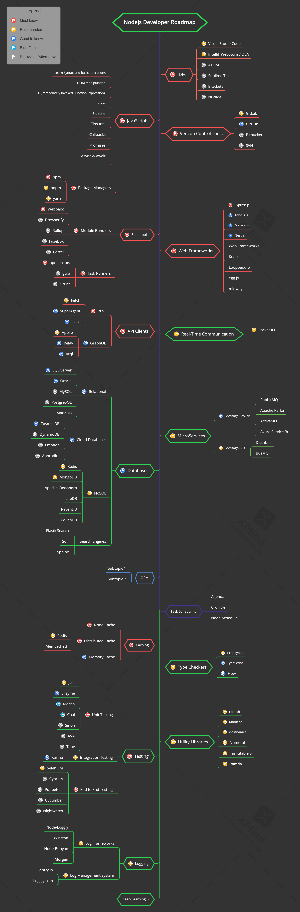

# Node.js Developer Roadmap

> A practical, developer-focused **roadmap** to becoming a **Node.js Developer** in 2026 — covering the essential tools, libraries, and concepts you need along the way.

Below you can find a chart demonstrating the paths that you can take and the libraries that you would want to learn to become a Node.js developer. I made this chart as a tip for everyone who asks me, "What should I learn next as a Node.js developer?"

## Table of Contents

| No. | Topic                                                 |
| --- | ----------------------------------------------------- |
| 1   | [Roadmap](#1-roadmap)                                 |
| 2   | [IDEs](#2-ides)                                       |
| 3   | [JavaScript](#3-javascript)                           |
| 4   | [Build Tools](#4-build-tools)                         |
| 5   | [Web Frameworks](#5-web-frameworks)                   |
| 6   | [API Clients](#6-api-clients)                         |
| 7   | [Real-Time Communication](#7-real-time-communication) |
| 8   | [Microservices](#8-microservices)                     |
| 9   | [Task Scheduling](#9-task-scheduling)                 |
| 10  | [ORM](#10-orm)                                        |
| 11  | [Databases](#11-databases)                            |
| 12  | [Security Libraries](#12-security-libraries)          |
| 13  | [Utility Libraries](#13-utility-libraries)            |
| 14  | [Type Checkers](#14-type-checkers)                    |
| 15  | [Logging](#15-logging)                                |
| 16  | [Testing](#16-testing)                                |

## 1. Roadmap

    

**[⬆ Back to Top](#table-of-contents)**

## 2. IDEs

| IDE                                                          | Short Description                               | Pricing      |
| ------------------------------------------------------------ | ----------------------------------------------- | ------------ |
| [Visual Studio Code](https://code.visualstudio.com/Download) | Lightweight and highly extensible code editor.  | **Free**     |
| [WebStorm](https://www.jetbrains.com/webstorm/)              | Powerful IDE for modern JavaScript development. | **Freemium** |
| [Cursor](https://www.cursor.com/)                            | AI-powered code editor with smart assistance.   | **Freemium** |
| [Sublime Text](https://www.sublimetext.com/)                 | Fast and customizable lightweight editor.       | **Paid**     |
| [Neovim](https://neovim.io/)                                 | Hyperextensible Vim-based text editor.          | **Free**     |
| [Zed](https://zed.dev/)                                      | High-performance collaborative code editor.     | **Free**     |

**[⬆ Back to Top](#table-of-contents)**

## 3. JavaScript

_Basic_

- [w3schools](https://www.w3schools.com/js/default.asp) JavaScript Tutorial
- [developer.mozilla](https://developer.mozilla.org/en-US/docs/Web/JavaScript) JavaScript
- [javascript.info](https://javascript.info/) The Modern JavaScript Tutorial
- [htmlcheatsheet](https://htmlcheatsheet.com/js/) JS CheatSheet

_ES6_

- [exploringjs](https://exploringjs.com/es6/index.html) Exploring ES6
- [compat-table](https://compat-table.github.io/compat-table/es6/) ECMAScript 6 compatibility table
- [babeljs](https://babeljs.io/docs/en/learn) Learn ES2015
- [github](https://github.com/lukehoban/es6features) ECMAScript 6
- [github](https://github.com/sudheerj/ECMAScript-features) ECMAScript 6

_Style Guide_

- [github](https://github.com/airbnb/javascript) Airbnb JavaScript Style Guide
- [github](https://github.com/ryanmcdermott/clean-code-javascript) clean-code-javascript

_Playground_

- [js-array-playground](https://js-array-playground.firebaseapp.com/) JavaScript Array Playground
- [jsfiddle](https://jsfiddle.net/)
- [plnkr](https://plnkr.co/)
- [jsbin](https://jsbin.com/?html,output)
- [codepen](https://codepen.io/pen/)
- [stackblitz](https://stackblitz.com/)

**[⬆ Back to Top](#table-of-contents)**

## 4. Build Tools

- Package Managers
  - [npm](https://www.npmjs.com/)
  - [yarn](https://yarnpkg.com/)
  - [pnpm](https://pnpm.io/)
- Task Runners
  - [npm scripts](https://docs.npmjs.com/cli/using-npm/scripts)
  - [nodemon](https://www.npmjs.com/package/nodemon)
  - [pm2](https://pm2.keymetrics.io/)
  - [gulp](https://gulpjs.com/)
  - [grunt](https://gruntjs.com/)
  - [forever](https://github.com/foreversd/forever)
- Module Bundlers
  - [esbuild](https://esbuild.github.io/)
  - [Vite](https://vitejs.dev/)
  - [tsup](https://tsup.egoist.dev/)
  - [SWC](https://swc.rs/)
  - [Webpack](https://webpack.js.org/)
  - [Rollup](https://rollupjs.org/)
  - [Bazel](https://bazel.build/)

**[⬆ Back to Top](#table-of-contents)**

## 5. Web Frameworks

- [Express.js](https://expressjs.com/) - Fast, unopinionated, minimalist web framework
- [Fastify](https://fastify.dev/) - Fast and low overhead web framework with built-in schema validation
- [Nest.js](https://nestjs.com/) - Progressive framework for building efficient, scalable server-side applications
- [Koa.js](https://koajs.com/) - Expressive middleware framework by the Express team
- [Hono](https://hono.dev/) - Ultrafast web framework built on Web Standard APIs
- [Hapi](https://hapi.dev/) - Rich framework for building applications and services
- [Adonis.js](https://adonisjs.com/) - Full-featured MVC framework for Node.js
- [Meteor.js](https://www.meteor.com/) - Full-stack JavaScript platform
- [Sails.js](https://sailsjs.com/) - Realtime MVC framework
- [Loopback.io](https://loopback.io/) - Highly extensible API framework
- [egg.js](https://eggjs.org/en/index.html) - Enterprise framework built on Koa

**[⬆ Back to Top](#table-of-contents)**

## 6. API Clients

- REST
  - [Fetch](https://nodejs.org/api/globals.html#fetch) Native fetch API (Node.js 18+)
  - [axios](https://github.com/axios/axios)
  - [got](https://github.com/sindresorhus/got)
  - [SuperAgent](https://visionmedia.github.io/superagent/)
  - [ky](https://github.com/sindresorhus/ky)
- GraphQL
  - [Apollo](https://www.apollographql.com/docs/)
  - [graphql-request](https://github.com/jasonkuhrt/graphql-request)
  - [urql](https://github.com/FormidableLabs/urql)

**[⬆ Back to Top](#table-of-contents)**

## 7. Real-Time Communication

- [Socket.IO](https://socket.io/) - Bidirectional event-based communication with automatic reconnection and fallbacks
- [ws](https://github.com/websockets/ws) - Simple, fast, widely used WebSocket client/server for Node.js

**[⬆ Back to Top](#table-of-contents)**

## 8. Microservices

- Message Brokers
  - [RabbitMQ](https://www.rabbitmq.com/tutorials/tutorial-one-javascript.html)
  - [Apache Kafka](https://kafka.js.org/) (KafkaJS)
  - [NATS](https://nats.io/)
  - [ActiveMQ](https://activemq.apache.org/)
  - [Azure Service Bus](https://learn.microsoft.com/en-us/azure/service-bus-messaging/service-bus-messaging-overview)
- Frameworks
  - [Nest.js Microservices](https://docs.nestjs.com/microservices/basics)
  - [Moleculer](https://moleculer.services/)
  - [Seneca](https://senecajs.org/)

**[⬆ Back to Top](#table-of-contents)**

## 9. Task Scheduling

- [node-cron](https://github.com/node-cron/node-cron) - Cron-based scheduling in-process
- [node-schedule](https://www.npmjs.com/package/node-schedule) - Cron-like and date-based job scheduler
- [Agenda](https://github.com/agenda/agenda) - MongoDB-backed job scheduling
- [BullMQ](https://bullmq.io/) - Redis-based queues with repeatable jobs
- [Cronicle](https://github.com/jhuckaby/Cronicle) - Multi-server task scheduler with web UI

**[⬆ Back to Top](#table-of-contents)**

## 10. ORM

- [Prisma](https://www.prisma.io/) - Next-generation ORM with a type-safe auto-generated client
- [Drizzle](https://orm.drizzle.team/) - Lightweight TypeScript ORM with SQL-like syntax
- [TypeORM](https://typeorm.io/) - ORM for TypeScript and JavaScript supporting MySQL, PostgreSQL, MariaDB, SQLite, MS SQL Server, Oracle, and SAP Hana
- [Sequelize](https://sequelize.org/) - Promise-based ORM compatible with MariaDB, PostgreSQL, MySQL, SQLite, and Microsoft SQL Server
- [Mongoose](https://mongoosejs.com/) - MongoDB object modeling for Node.js
- [Knex](https://knexjs.org/) - SQL query builder for PostgreSQL, MySQL, SQL Server, SQLite3, and Oracle

**[⬆ Back to Top](#table-of-contents)**

## 11. Databases

- Relational
  - [PostgreSQL](https://www.postgresql.org/)
  - [MySQL](https://www.mysql.com/)
  - [MariaDB](https://mariadb.org/)
  - [SQLite](https://sqlite.org/)
  - [SQL Server](https://www.microsoft.com/sql-server/)
  - [Oracle](https://www.oracle.com/database/technologies/oracle-database-software-downloads.html)
- Cloud Databases
  - [CosmosDB](https://learn.microsoft.com/en-us/azure/cosmos-db/)
  - [DynamoDB](https://aws.amazon.com/dynamodb/)
  - [Firestore](https://firebase.google.com/docs/firestore)
- NoSQL
  - [MongoDB](https://www.mongodb.com/)
  - [Redis](https://redis.io/)
  - [Apache Cassandra](https://cassandra.apache.org/)
  - [CouchDB](https://couchdb.apache.org/)
  - [Neo4j](https://neo4j.com/)
  - [RavenDB](https://ravendb.net/)

**[⬆ Back to Top](#table-of-contents)**

## 12. Security Libraries

- [helmet](https://helmetjs.github.io/) - Secure HTTP headers middleware
- [cors](https://github.com/expressjs/cors) - Cross-Origin Resource Sharing middleware
- [bcryptjs](https://github.com/dcodeIO/bcrypt.js) - Password hashing
- [jsonwebtoken](https://github.com/auth0/node-jsonwebtoken) - JWT signing and verification
- [express-jwt](https://github.com/auth0/express-jwt) - JWT authentication middleware
- [joi](https://joi.dev/) - Schema and input validation
- [zod](https://zod.dev/) - TypeScript-first schema validation
- [express-rate-limit](https://github.com/express-rate-limit/express-rate-limit) - Rate limiting middleware
- [Passport](https://www.passportjs.org/) - Authentication middleware
- [Auth0](https://auth0.com/blog/complete-guide-to-nodejs-express-user-authentication/) - Complete guide to Node.js authentication

**[⬆ Back to Top](#table-of-contents)**

## 13. Utility Libraries

- [Lodash](https://lodash.com/)
- [Ramda](https://ramdajs.com/)
- [Moment](https://momentjs.com/) (maintenance mode – consider [date-fns](https://date-fns.org/), [Day.js](https://day.js.org/), or [Luxon](https://moment.github.io/luxon/))
- [Numeral](https://numeraljs.com/)
- [ImmutableJS](https://facebook.github.io/immutable-js/)
- [Async.js](https://caolan.github.io/async/)
- [commander](https://github.com/tj/commander.js/) - CLI argument parsing
- [dotenv](https://github.com/motdotla/dotenv) - Environment variable loading
- [uuid](https://github.com/uuidjs/uuid) - RFC-compliant UUID generation

**[⬆ Back to Top](#table-of-contents)**

## 14. Type Checkers

- [TypeScript](https://www.typescriptlang.org/)
- [JSDoc](https://www.typescriptlang.org/docs/handbook/jsdoc-supported-types.html) - TypeScript checking in plain JavaScript files
- [Flow](https://flow.org/en/)

**[⬆ Back to Top](#table-of-contents)**

## 15. Logging

- Log Frameworks
  - [Pino](https://getpino.io/) - Very low overhead JSON logger
  - [Winston](https://github.com/winstonjs/winston)
  - [Node-Bunyan](https://github.com/trentm/node-bunyan)
  - [Morgan](https://github.com/expressjs/morgan) - HTTP request logger middleware
- Log Management Systems
  - [Sentry.io](https://sentry.io/)
  - [Loggly.com](https://loggly.com/)
  - [Datadog](https://www.datadoghq.com/)

**[⬆ Back to Top](#table-of-contents)**

## 16. Testing

- Unit Testing
  - [Jest](https://jestjs.io/)
  - [Vitest](https://vitest.dev/)
  - [node:test](https://nodejs.org/api/test.html) - Built-in test runner
  - [Mocha](https://mochajs.org/)
  - [Chai](https://www.chaijs.com/)
  - [Sinon](https://sinonjs.org/)
  - [AVA](https://github.com/avajs/ava)
  - [Tape](https://github.com/tape-testing/tape)
- Integration Testing
  - [Supertest](https://github.com/ladjs/supertest) - HTTP assertion library
- End to End Testing
  - [Playwright](https://playwright.dev/)
  - [Cypress](https://www.cypress.io/)
  - [Puppeteer](https://pptr.dev/)
  - [WebdriverIO](https://webdriver.io/)
  - [Nightwatch.js](https://nightwatchjs.org/)
  - [Cucumber.js](https://github.com/cucumber/cucumber-js)

> Note: [Enzyme](https://github.com/enzymejs/enzyme) is effectively unmaintained and does not support React 18+, and [Karma](https://karma-runner.github.io/) is discontinued — prefer Vitest/Jest and Playwright/Cypress.

**[⬆ Back to Top](#table-of-contents)**

## Author

**Md. Saiful Islam**
_Microsoft Certified Solutions Developer (MCSD) – Programming in C#_

**GitHub:** [@saifaustcse](https://github.com/saifaustcse)
**LinkedIn:** [Md. Saiful Islam](https://www.linkedin.com/in/saif-aust-cse/)

If you find this roadmap useful, please give :star:. Your support is appreciated!
